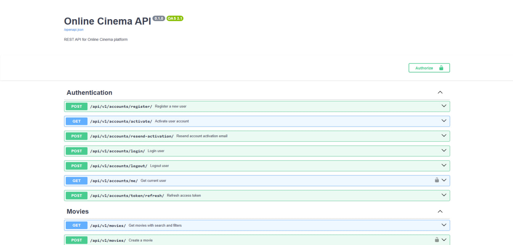
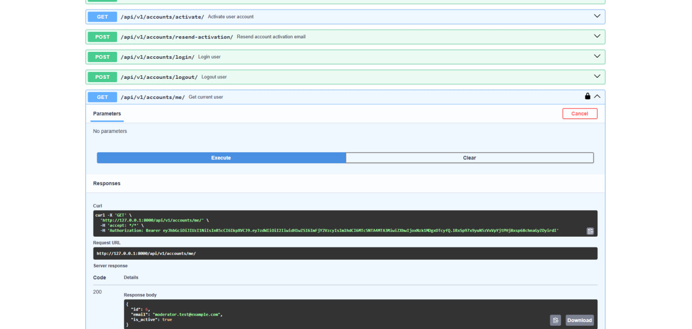

# Online Cinema API

Online Cinema is a REST API built with FastAPI for user authentication and movie catalog management.

The application supports email-based account activation, JWT authentication, movie search, filtering, pagination, and role-based movie management.

## Features

### User Registration
- Register with email and password
- Password hashing
- Email activation (valid for 24 hours)
- Resend activation email
- Automatic cleanup of expired activation tokens

### Authentication
- JWT login
- Access and refresh tokens
- Refresh access token
- Logout with refresh token revocation
- Get current authenticated user

### Movie Catalog
- List available movies
- Pagination
- Get movie details
- Search by title and description
- Filter by rating and release date
- Sort by name, rating, release date, or ID

### Movie Management
- Create movies
- Update movies
- Delete movies
- Role-based permissions:
  - USER: read-only access
  - MODERATOR: manage movies
  - ADMIN: manage movies

### Installation

Clone the repository:

```bash
git clone https://github.com/KiporenkoMaksym/online-cinema-fastapi
cd online-cinema-fastapi

poetry install

docker compose up -d

poetry run alembic upgrade head

poetry run uvicorn src.main:app --reload

poetry run pytest tests/ -v
```

## Demo




