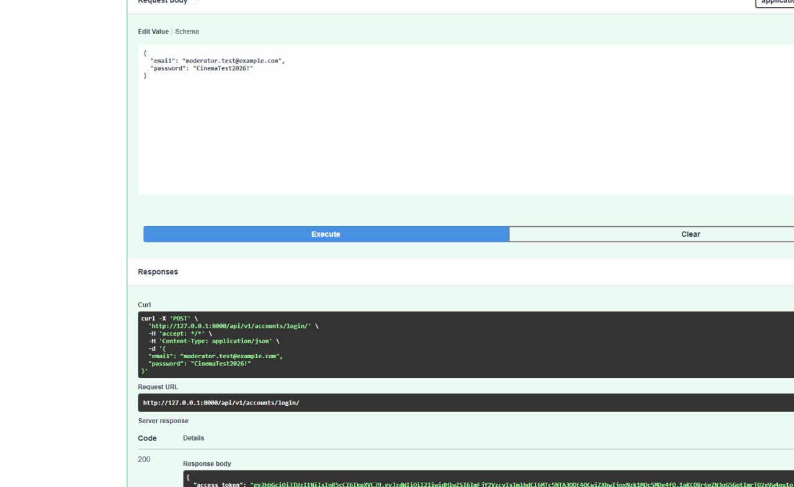
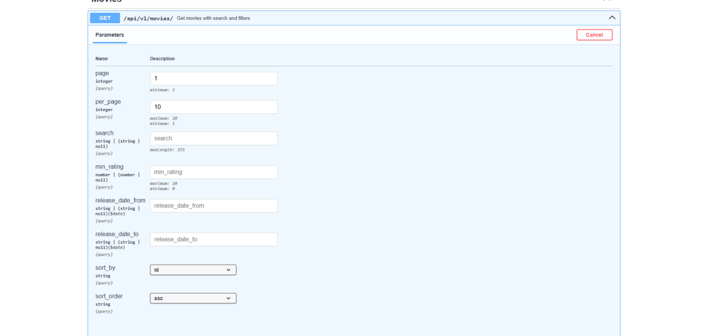
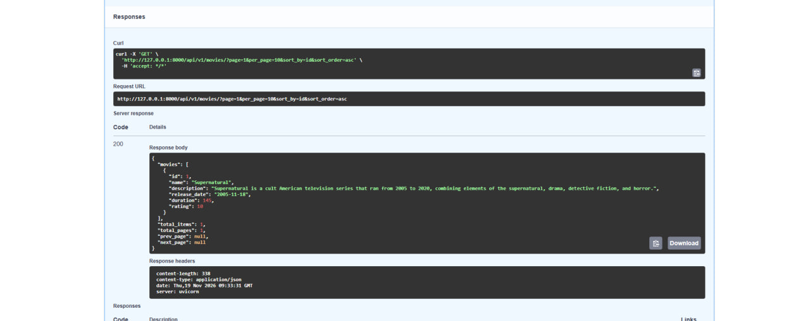

# Online Cinema API

Online Cinema is a REST API built with FastAPI for user authentication and movie catalog management.

The application supports email-based account activation, JWT authentication, movie search, filtering, pagination, role-based movie management,
and background tasks using Celery and Redis.

## Technologies

- Python 3.13
- FastAPI
- PostgreSQL 16
- SQLAlchemy (Async)
- Alembic
- Pydantic
- JWT Authentication
- Redis
- Celery Worker and Celery Beat
- MailHog
- Docker and Docker Compose
- Poetry
- Pytest
- Flake8

## Features

### User Management

- Register users with email and password
- Secure password hashing
- Email-based account activation
- Activation tokens valid for 24 hours
- Resend activation emails
- Automatic cleanup of expired activation tokens using Celery

### Authentication

- Login with email and password
- JWT access and refresh tokens
- Refresh expired access tokens
- Logout with refresh token revocation
- Retrieve current authenticated user

### Movie Catalog

- Browse available movies
- View movie details
- Search by title and description
- Filter by minimum rating
- Filter by release date range
- Sort by ID, name, release date, or rating
- Paginate movie results

### Movie Management

Role-based permissions:

- USER — read-only access to movies
- MODERATOR — create, update, and delete movies
- ADMIN — create, update, and delete movies

Movie listing and detail endpoints are publicly accessible.

## Installation and Setup

### Prerequisites

Install the following tools:

- Git
- Docker and Docker Compose
- Python 3.13 and Poetry (for local development)

### 1. Clone the repository

```bash
git clone https://github.com/KiporenkoMaksym/online-cinema-fastapi.git
cd online-cinema-fastapi
```

### 2. Configure environment variables

Create a `.env` file from the provided template.

On Windows CMD:

```cmd
copy .env.example .env
```

On Linux/macOS:

```bash
cp .env.example .env
```

Edit `.env` and replace `JWT_SECRET_KEY` with a secure random key.

Generate a random key with Python:

```bash
python -c "import secrets; print(secrets.token_hex(32))"
```

Never commit `.env` or production credentials to Git.

### Environment Variables

| Variable | Description |
|---|---|
| `DATABASE_URL` | PostgreSQL connection URL |
| `JWT_SECRET_KEY` | Secret key for signing JWT tokens |
| `JWT_ALGORITHM` | JWT signing algorithm, default `HS256` |
| `ACCESS_TOKEN_EXPIRE_MINUTES` | Access token lifetime, default 15 minutes |
| `REFRESH_TOKEN_EXPIRE_DAYS` | Refresh token lifetime, default 7 days |
| `CELERY_BROKER_URL` | Redis URL for the Celery broker |
| `CELERY_RESULT_BACKEND` | Redis URL for Celery task results |
| `SMTP_HOST` | SMTP server hostname |
| `SMTP_PORT` | SMTP server port |
| `SMTP_FROM_EMAIL` | Sender email address |
| `BASE_URL` | Public application base URL used in activation emails |

The `.env.example` file contains example values for local development.

When running the complete application through Docker Compose, internal service addresses are configured in `docker-compose.yml`.

For Docker Compose, set `BASE_URL=http://127.0.0.1:8001` in `.env` so activation links use the exposed API port.

For a local Uvicorn process running on port 8000, use `BASE_URL=http://127.0.0.1:8000`.

Production deployments should use their actual public HTTPS URL.

### 3. Start Docker services

Build and start the services:

```bash
docker compose up -d --build
```

This starts:

- FastAPI application
- PostgreSQL database
- Redis
- MailHog
- Celery Worker
- Celery Beat

Check service status:

```bash
docker compose ps
```

### 4. Apply database migrations

Database migrations are managed with Alembic.

Run migrations inside the API container:

```bash
docker compose exec api alembic upgrade head
```

Migrations must be applied before using database-dependent endpoints.

### 5. Access the application

After starting the Docker services:

| Service | URL |
|---|---|
| API documentation (Swagger) | http://127.0.0.1:8001/docs |
| OpenAPI schema | http://127.0.0.1:8001/openapi.json |
| Health check | http://127.0.0.1:8001/health |
| MailHog interface | http://127.0.0.1:8025 |

The `/health` endpoint returns:

```json
{
  "status": "ok"
}
```

The local application exposes Swagger documentation through FastAPI. Deployed environments may use additional access protection at the reverse proxy.

### 6. Alternative: Local development with Poetry

Install project dependencies:

```bash
poetry install
```

Start PostgreSQL, Redis, and MailHog:

```bash
docker compose up -d db redis mailhog
```

Make sure the `.env` file uses the local service addresses and ports.

Apply migrations:

```bash
poetry run alembic upgrade head
```

Start FastAPI:

```bash
poetry run uvicorn src.main:app --reload
```

The local development API is available at:

`http://127.0.0.1:8000`

To use the scheduled background tasks during local development, start Celery Worker and Celery Beat in separate terminals, using the environment configured for local Redis and PostgreSQL.

### 7. Run tests

Run the test suite:

```bash
poetry run pytest tests/ -v
```

Generate a coverage report:

```bash
poetry run pytest tests/ --cov=src --cov-report=term-missing
```

Generate an HTML coverage report:

```bash
poetry run pytest tests/ --cov=src --cov-report=html
```

The HTML report is generated in the `htmlcov/` directory.

These coverage commands require the `pytest-cov` package.

## API Documentation

The API endpoints use the `/api/v1/` prefix.

Interactive OpenAPI documentation is available through Swagger UI.

### Authentication Endpoints

Base URL: `/api/v1/accounts`

| Method | Endpoint | Description | Permission |
|---|---|---|---|
| POST | `/register/` | Register a user and send an activation email | Public |
| GET | `/activate/` | Activate an account using an email token | Public |
| POST | `/resend-activation/` | Request a new activation email | Public |
| POST | `/login/` | Authenticate and receive JWT tokens | Public |
| POST | `/logout/` | Revoke a refresh token | Valid refresh token |
| GET | `/me/` | Get current user information | Authenticated |
| POST | `/token/refresh/` | Generate a new access token | Valid refresh token |

#### Register User

`POST /api/v1/accounts/register/`

Request body:

```json
{
  "email": "user@example.com",
  "password": "SecurePass123!"
}
```

Password requirements:

- At least 8 characters
- At least one uppercase letter
- At least one lowercase letter
- At least one digit
- At least one special character

Successful registration returns HTTP `201 Created` with the user's ID, email, and activation status.

Possible errors include:

- `409 Conflict` — email already registered
- `422 Unprocessable Entity` — invalid registration data

#### Activate Account

`GET /api/v1/accounts/activate/?token=YOUR_TOKEN`

Required query parameter:

- `token` — activation token received by email

The activation token is valid for 24 hours.

Invalid or expired activation tokens return HTTP `400 Bad Request`.

#### Resend Activation Email

`POST /api/v1/accounts/resend-activation/`

Request body:

```json
{
  "email": "user@example.com"
}
```

For an existing inactive account, the application generates a new activation token and sends an email.

The endpoint returns a generic response to avoid revealing account existence.

#### Login

`POST /api/v1/accounts/login/`

Request body:

```json
{
  "email": "user@example.com",
  "password": "SecurePass123!"
}
```

Successful authentication returns:

```json
{
  "access_token": "JWT_ACCESS_TOKEN",
  "refresh_token": "JWT_REFRESH_TOKEN",
  "token_type": "bearer"
}
```

Possible errors:

- `401 Unauthorized` — invalid credentials
- `403 Forbidden` — account is not activated

#### Get Current User

`GET /api/v1/accounts/me/`

Requires an access token in the Authorization header:

```http
Authorization: Bearer YOUR_ACCESS_TOKEN
```

Returns the current user's ID, email, and activation status.

#### Refresh Access Token

`POST /api/v1/accounts/token/refresh/`

Request body:

```json
{
  "refresh_token": "YOUR_REFRESH_TOKEN"
}
```

Returns a new access token.

Invalid or revoked refresh tokens return HTTP `401 Unauthorized`.

#### Logout

`POST /api/v1/accounts/logout/`

Request body:

```json
{
  "refresh_token": "YOUR_REFRESH_TOKEN"
}
```

Revokes the provided refresh token so that it cannot be used again.

An invalid or revoked refresh token returns HTTP `401 Unauthorized`.

### Movie Endpoints

Base URL: `/api/v1/movies`

| Method | Endpoint | Description | Permission |
|---|---|---|---|
| GET | `/` | List movies with pagination, search, filtering, and sorting | Public |
| GET | `/{movie_id}/` | Retrieve movie details | Public |
| POST | `/` | Create a movie | Moderator / Admin |
| PUT | `/{movie_id}/` | Update a movie | Moderator / Admin |
| DELETE | `/{movie_id}/` | Delete a movie | Moderator / Admin |

#### List Movies

`GET /api/v1/movies/`

Supported query parameters:

| Parameter | Type | Default | Description |
|---|---|---|---|
| `page` | integer | 1 | Page number, minimum 1 |
| `per_page` | integer | 10 | Items per page, from 1 to 20 |
| `search` | string | null | Search query, maximum 255 characters |
| `min_rating` | float | null | Minimum rating, from 0 to 10 |
| `release_date_from` | date | null | Minimum release date |
| `release_date_to` | date | null | Maximum release date |
| `sort_by` | string | id | `id`, `name`, `release_date`, or `rating` |
| `sort_order` | string | asc | `asc` or `desc` |

Dates use the `YYYY-MM-DD` format.

If `release_date_from` is later than `release_date_to`, the API returns HTTP `422`.

Example request:

```http
GET /api/v1/movies/?page=1&per_page=10&min_rating=7&sort_by=rating&sort_order=desc
```

The response contains:

- `movies` — list of movie objects
- `total_items` — total number of matching movies
- `total_pages` — total number of pages
- `prev_page` — previous page number, or null
- `next_page` — next page number, or null

#### Get Movie Details

`GET /api/v1/movies/{movie_id}/`

Path parameter:

- `movie_id` — integer movie identifier

Returns the movie's ID, name, description, release date, duration, and rating.

Returns HTTP `404 Not Found` if the movie does not exist.

#### Create Movie

`POST /api/v1/movies/`

Requires authentication as a moderator or administrator.

Request body:

```json
{
  "name": "Example Movie",
  "description": "An example movie description.",
  "release_date": "2026-01-15",
  "duration": 120,
  "rating": 8.5
}
```

Field validation:

| Field | Required | Validation |
|---|---|---|
| `name` | Yes | Non-empty string, maximum 255 characters |
| `description` | No | String or null |
| `release_date` | Yes | Valid date in `YYYY-MM-DD` format |
| `duration` | Yes | Positive integer |
| `rating` | No | Number between 0 and 10, or null |

Successful creation returns HTTP `201 Created`.

#### Update Movie

`PUT /api/v1/movies/{movie_id}/`

Requires moderator or administrator permissions.

Path parameter:

- `movie_id` — integer movie identifier

Uses the same request schema and validation rules as movie creation.

The request must include the required fields `name`, `release_date`, and `duration`.

Returns HTTP `404 Not Found` when the movie does not exist.

#### Delete Movie

`DELETE /api/v1/movies/{movie_id}/`

Requires moderator or administrator permissions.

Path parameter:

- `movie_id` — integer movie identifier

On successful deletion, the endpoint returns HTTP `204 No Content`.

Returns HTTP `404 Not Found` if the movie does not exist.

### Authentication and Permissions

The application uses JWT bearer authentication.

Access tokens are required for protected endpoints.

Regular users can browse the movie catalog but cannot create, update, or delete movies.

Only MODERATOR and ADMIN roles can manage movie records.

Refresh tokens are used for renewing access tokens and revoking refresh sessions.

### Background Tasks

Celery is integrated with Redis for background task processing.

Celery Beat schedules the cleanup of expired activation tokens every hour.

The application includes:

- `celery_worker` — executes background tasks
- `celery_beat` — schedules periodic tasks
- `redis` — message broker and task result backend

### Email Testing

MailHog is used for local email testing.

After user registration, open:

`http://127.0.0.1:8025`

Find the activation email and follow the link to activate the account.

MailHog is intended for development and testing, not production email delivery.

## Database Migrations

Create a new migration after changing database models:

```bash
poetry run alembic revision --autogenerate -m "Describe migration"
```

Apply all pending migrations:

```bash
poetry run alembic upgrade head
```

Check the current migration:

```bash
poetry run alembic current
```

For Docker-based deployments, run Alembic inside the API container.

## Development

Code quality checks use Flake8.

The project uses Git branches and Pull Requests for feature development and code review.

## Demo





